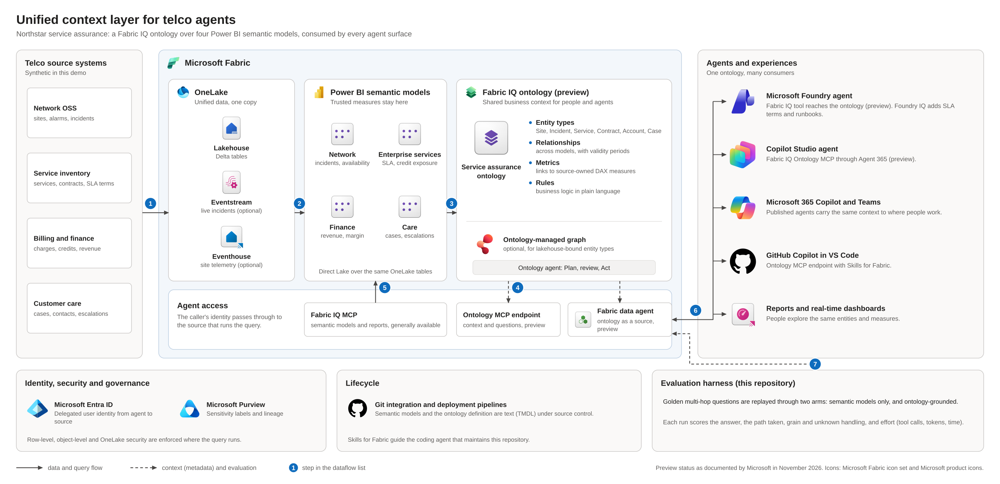

# Northstar: Fabric IQ ontology demo for telco

A [Fabric IQ ontology](https://learn.microsoft.com/en-us/fabric/iq/ontology/overview) (preview, checked 16 November 2026) over existing Power BI semantic models as one shared context layer for telecommunications agents.

- **Semantic models keep the calculations:** DAX measures, table grains, and row-level security stay in Power BI semantic models.
- **The ontology adds connected context:** entity types, cross-model relationships, metrics linked to source measures, and plain-language rules live in one reviewable item.
- **Many agents share one definition:** agents across Microsoft Fabric, Microsoft Foundry, Microsoft Copilot Studio, Microsoft 365 Copilot, and GitHub Copilot read the same business meaning.

[](docs/architecture/README.md)

## See it in ten minutes

Requires Python 3.12+ and Node.js 24+. Create and activate a virtual environment:

```bash
python -m venv .venv
source .venv/bin/activate        # Linux / macOS (bash or zsh; use python3 if needed)
# .\.venv\Scripts\Activate.ps1   # Windows (PowerShell)
```

Install the locked dependencies, build the web app, and start the recorded demo (identical in bash and PowerShell):

```bash
python -m pip install -r requirements.lock
python -m pip install --no-deps -e .
npm --prefix apps/web ci
npm --prefix apps/web run build
northstar serve --recorded-library recordings/northstar-demo-library-v2-2026-10-28.json --port 8767
```

Open `http://localhost:8767/`. Recorded mode replays sanitized synthetic captures from `recordings/` with no sign-in, model call, or Microsoft Fabric query (`./tools/start-demo.ps1` is an optional PowerShell wrapper). For server modes, live demo user setup, and talk tracks, see [docs/run/streams.md](docs/run/streams.md) and [docs/presenter/README.md](docs/presenter/README.md).

## The scenario

All customer names, accounts, contracts, sites, incidents, and amounts in this repository are synthetic. After a network outage, a service-assurance lead asks one question across four domains:

> Which enterprise customers were served from sites hit by July incidents, what SLA credit exposure do we carry on their contracts, how much revenue and margin is at stake, and who already has escalated cases?

Answering it crosses four Direct Lake Power BI semantic models — **Network**, **Enterprise services**, **Finance**, and **Care** — across time-valid site assignments and separate contract-month and account-month grains.

- **Service assurance scenario specification:** [docs/architecture/hero-scenario.md](docs/architecture/hero-scenario.md) and the [service assurance ontology map](docs/architecture/images/service-assurance-ontology.png)
- **Agent surfaces, captures, and Microsoft 365 Copilot routing:** [docs/agents/README.md](docs/agents/README.md)
- **Twenty-minute service assurance run of show:** [docs/presenter/service-assurance.md](docs/presenter/service-assurance.md)
- **Two-model quickstart opener (Subscriptions and Finance):** [docs/scenario/quickstart.md](docs/scenario/quickstart.md)
- **Full documentation index:** [docs/README.md](docs/README.md)

## What is in the repository

| Folder | Contents |
|---|---|
| `agents/` | Shared agent instructions, starter prompts, Microsoft Foundry builder, and Microsoft Copilot Studio setup assets ([docs/agents/README.md](docs/agents/README.md)) |
| `apps/web/` | React and TypeScript viewer for recorded evidence, ontology maps, agent surface captures, and side-by-side comparisons |
| `contracts/` | JSON Schemas for context, typed query plans, and execution results |
| `data/` | Synthetic data contracts (`data/contracts/`) and miniature Parquet fixtures (`data/fixtures/`) |
| `docs/` | Architecture, scenario, run, presenter, deployment, and reference guides ([docs/README.md](docs/README.md)) |
| `eval/` | Independent offline oracle, evaluation runners, and validation register (excluded from runtime packaging) |
| `fabric/` | Direct Lake semantic model templates (`fabric/semantic-models/`), ontology contracts, and AI preparation drafts |
| `infra/` | Guarded deployment staging, renewal templates, and live transport helpers |
| `recordings/` | Sanitized recorded demo streams and evaluation runs ([recordings/README.md](recordings/README.md)) |
| `src/telco_iq/` | Guarded Python runtime, `northstar` CLI, MCP clients, and typed plan validators |
| `tests/` | Offline Python test suite and sanitized acceptance fixtures |
| `tools/` | Data and model generators, sanitization, wording, and link checks |

## Status

An evaluation arm is one tested configuration given the same question, semantic models, and model-level AI preparation.

| Area | Status (checked 17 November 2026) | Details |
|---|---|---|
| Synthetic data, Direct Lake templates, and viewer | Works offline today | Deterministic generator, eight TMDL semantic models (64 governed measures), guarded runtime, and sanitized October 28 and November 17 recordings |
| Fabric IQ MCP server (semantic models and reports) | Generally available | Read-only semantic-model discovery and DAX execution under delegated user identity ([Microsoft Learn](https://learn.microsoft.com/en-us/fabric/iq/connectors/fabric-iq-mcp)) |
| Fabric IQ ontology, ontology agent in Fabric, and ontology MCP endpoint | Preview | Item-scoped ontology authoring, metrics linked to source measures, plain-language rules, and Microsoft Foundry / Microsoft Copilot Studio connections ([docs/architecture/platform-status.md](docs/architecture/platform-status.md)) |
| Agent surfaces and service assurance benchmark | Live Foundry + MCP + `k = 5` scorecard published | Four agent surface guides and captures in [docs/agents/README.md](docs/agents/README.md) (published Copilot Studio agent routes into Microsoft 365 Copilot and Teams; Fabric data agent over semantic-model bindings does not work); 17 November 2026 `k = 5` live scorecard in [recordings/evaluation/2026-11-17/scorecard.json](recordings/evaluation/2026-11-17/scorecard.json) ([design and claims policy](docs/evaluation/README.md)); remaining checks in [docs/evaluation/validation-backlog.md](docs/evaluation/validation-backlog.md) |

### What the 17 November 2026 live scorecard shows

In the 17 November 2026 demo tenant run (`405` runs: `27` questions × `3` evaluation arms × `k = 5` repeats on `F8` in `Central US`, `gpt-5-mini (2025-08-07)`, `service_default` toolset; [scorecard.json](recordings/evaluation/2026-11-17/scorecard.json), [scorecard.html](recordings/evaluation/2026-11-17/scorecard.html)):

- **Single-model `L1` controls tie (`86.7%`, `26/30` per evaluation arm):** all three evaluation arms perform identically on one-model questions (`0.0` difference).
- **Overall exact-match accuracy is an inconclusive tie (`28.1%` Arm A, `30.4%` Arm A+, `32.6%` Arm B):** the 95% paired bootstrap intervals (`Arm B vs Arm A`: `[-0.7%, +11.1%]`; `Arm B vs Arm A+`: `[-0.7%, +6.7%]`) include zero, so no overall exact-match accuracy advantage is claimed ([docs/evaluation/README.md](docs/evaluation/README.md)).
- **Trap avoidance, cohort F1, and effort trade-offs:** both prompt-carried rules (`Arm A+`) and the ontology (`Arm B`) reduce `missing-as-zero` (`R5`) trap hits from `16` (`Arm A`) to `0` (`99.3%` and `97.8%` unknown-handling accuracy vs `86.7%` in [scorecard.json](recordings/evaluation/2026-11-17/scorecard.json)). `Arm B` achieves higher returned-key cohort F1 (`0.734` vs `0.609` on `Arm A+` and `0.598` on `Arm A`), while using more mean tool calls (`8.91` vs `7.30` and `7.42`) and more tokens (`15.47M` total vs `10.97M` and `10.77M`). Keeping entities, bridges, metrics linked to source measures, and rules in one ontology avoids duplicating rules across individual agent prompts.

## Deploy to your demo tenant

Keep all demo tenant, workspace, and item identifiers, credentials, and live approval files outside the repository and outside cloud-synchronized folders. Never delete or empty a Microsoft Fabric workspace. Follow [docs/deploy/quickstart-ontology.md](docs/deploy/quickstart-ontology.md) to reproduce the quickstart ontology in Fabric and [docs/deploy/automation-boundaries.md](docs/deploy/automation-boundaries.md) for API and authoring boundaries.

## Use your own semantic models

Ontology binding requires Direct Lake semantic models over OneLake Delta tables; Import-mode semantic models and Direct Lake models in workspaces with inbound public access disabled are not supported in preview (checked 16 November 2026; see [Microsoft Learn troubleshooting](https://learn.microsoft.com/en-us/fabric/iq/ontology/resources-troubleshooting)). See [docs/reference/data-models.md](docs/reference/data-models.md) for semantic-model conventions and [docs/develop/agent-tooling.md](docs/develop/agent-tooling.md) for Skills for Fabric and MCP editor setup.

## Limitations

See [docs/limitations.md](docs/limitations.md) for what the offline repository and sanitized recordings show versus what requires live verification in a demo tenant.

## Contributing, security, licence, and trademarks

- **Contribute and run checks:** [CONTRIBUTING.md](CONTRIBUTING.md) · **Support:** [SUPPORT.md](SUPPORT.md)
- **Security:** [SECURITY.md](SECURITY.md) (vulnerability reporting) and [docs/security.md](docs/security.md) (delegated identity and governance boundaries)
- **Licence:** Released under the [MIT License](LICENSE).

This repository is a sample demonstration and accelerator, and is not an official Microsoft product or supported offering.

Microsoft, Power BI, Microsoft Fabric, OneLake, Microsoft Purview, Microsoft Entra, Microsoft Foundry, Microsoft Copilot Studio, Microsoft 365, Copilot, and GitHub are trademarks of the Microsoft group of companies. Product names and icons in documentation and architecture diagrams remain the property of their respective trademark owners; see [docs/architecture/icons/README.md](docs/architecture/icons/README.md).
