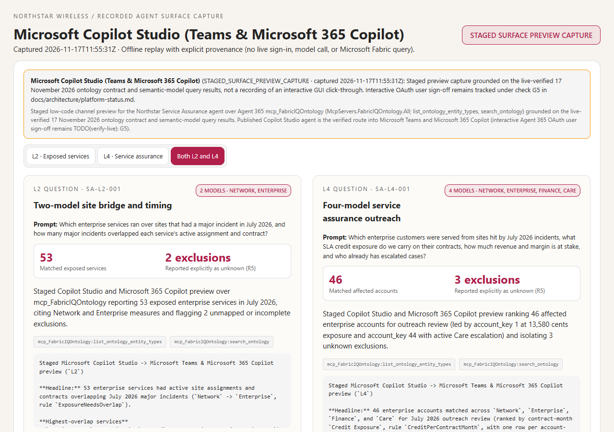

# Microsoft Copilot Studio service assurance agent

This tutorial walks from an empty Microsoft Copilot Studio agent to a published agent in **Microsoft Teams** and **Microsoft 365 Copilot** connected to `Northstar_Service_Assurance` in a demo tenant. It follows Microsoft Learn guidance in [Connect Copilot Studio to Fabric IQ Ontology MCP server](https://learn.microsoft.com/en-us/microsoft-copilot-studio/mcp-fabric-iq-ontology) (preview, checked 16 November 2026).

`TODO(verify-live): G5` — Run all five steps in the demo tenant and record the dated outcome in [../../docs/architecture/platform-status.md](../../docs/architecture/platform-status.md).

## Prerequisites

Confirm every requirement from Microsoft Learn before configuring the agent:

1. **Microsoft 365 Copilot licence**: Each maker and demo user needs a **Microsoft 365 Copilot** licence in the demo tenant, which is required for Agent 365 MCP server governance in the Microsoft 365 admin center ([Fabric IQ Ontology MCP for Copilot Studio](https://learn.microsoft.com/en-us/microsoft-copilot-studio/mcp-fabric-iq-ontology), checked 16 November 2026).
2. **Agent 365 governance and OAuth scope**: Allow the `mcp_FabricIQOntology` MCP server in the Microsoft 365 admin center under **Agents -> Tools** and consent to the delegated scope `McpServers.FabricIQOntology.All`.
3. **Fabric capacity**: Run the workspace on a paid `F2` or `P1` or higher Microsoft Fabric capacity ([Use the ontology MCP server](https://learn.microsoft.com/en-us/fabric/iq/ontology/how-to-use-ontology-mcp-server), checked 16 November 2026). Trial capacities are not supported.
4. **Fabric tenant setting**: Enable **Ontology item (preview)** in the Microsoft Fabric admin portal on the demo tenant, and confirm `Northstar_Service_Assurance` is published over the four Direct Lake semantic models (`Network`, `Enterprise services`, `Finance`, `Care`).
5. **Demo user permissions**: Grant the demo user maker access to the Microsoft Copilot Studio environment (`<ENVIRONMENT_ID>`) plus access to the Fabric workspace (`<WORKSPACE_ID>`), the ontology item (`<ONTOLOGY_ITEM_ID>`), and Read and Build permissions on all four semantic models.

## Agent 365 MCP server reference

Microsoft Copilot Studio routes `mcp_FabricIQOntology` (`Fabric IQ MCP (preview)`) through Agent 365 (preview, checked 16 November 2026):

- **Server name**: `mcp_FabricIQOntology`
- **Required scope**: `McpServers.FabricIQOntology.All`
- **Advertised tools**: `list_ontology_entity_types` and `search_ontology`
- **Tenant-scoped Agent 365 endpoint pattern**:
  `https://agent365.svc.cloud.microsoft/agents/tenants/<TENANT_ID>/servers/mcp_FabricIQOntology/workspaces/<WORKSPACE_ID>/ontologies/<ONTOLOGY_ITEM_ID>`
- **Environment-scoped Agent 365 endpoint pattern**:
  `https://agent365.svc.cloud.microsoft/mcp/environments/<ENVIRONMENT_ID>/servers/mcp_FabricIQOntology/workspaces/<WORKSPACE_ID>/ontologies/<ONTOLOGY_ITEM_ID>`

Do not commit real `<TENANT_ID>`, `<ENVIRONMENT_ID>`, `<WORKSPACE_ID>`, or `<ONTOLOGY_ITEM_ID>` values to the repository.

## Step 1: Create the agent in Microsoft Copilot Studio

1. Sign in to Microsoft Copilot Studio in the demo tenant and select the target environment (`<ENVIRONMENT_ID>`).
2. Select **Agents** -> **+ New agent**, then choose **Skip to configure** in the upper-right corner.
3. Set **Name** to `Northstar Service Assurance` and **Description** to `Answers cross-domain telco service assurance questions over the Northstar Fabric IQ ontology and recommends human-reviewed account priorities.`
4. Select **Create**, then verify **Generative orchestration** is enabled on the **Overview** page so the agent selects MCP tools dynamically.

## Step 2: Add the Fabric IQ Ontology MCP server

1. Open the **Tools** tab and select **+ Add a tool**.
2. Filter by **Model Context Protocol** and select **Fabric IQ Ontology** (`Fabric IQ MCP (preview)`, server identifier `mcp_FabricIQOntology`).
3. Create or choose a delegated connection, enter `<WORKSPACE_ID>` and `<ONTOLOGY_ITEM_ID>` for `Northstar_Service_Assurance`, and select **Add and configure**.
4. Under **Additional details -> Credentials to use**, keep **End user authentication** selected so every query runs with the signed-in demo user's Fabric permissions and semantic-model security roles.
5. Verify under **Tools** on the connector page that both advertised tools appear and are enabled:
   - `list_ontology_entity_types`
   - `search_ontology`

## Step 3: Paste the versioned instructions and starter prompts

1. Return to the **Overview** tab, select **Edit** on **Instructions**, paste the full contents of [instructions.md](instructions.md), and save. The instructions intentionally omit `R1` to `R5` formulas and rules so the agent reads business logic from the ontology at run time.
2. Scroll to **Suggested prompts**, add the four `L1` to `L4` titles and prompt texts from [starter-prompts.md](starter-prompts.md), and select **Save**.

## Step 4: Test in the Test pane

1. Open the **Test your agent** pane and turn on the **Activity map**.
2. Select the `L2` starter prompt (`Exposed enterprise services`). When prompted for permissions, select **Connect**, open **Connection manager**, authorize `mcp_FabricIQOntology` (`McpServers.FabricIQOntology.All`) as the demo user, and retry the turn.
3. Confirm in the activity map that the agent calls `list_ontology_entity_types` and `search_ontology`, cites the `Network` and `Enterprise` measures and home tables, and reports unmapped rows as exclusions.
4. Run the `L4` starter prompt (`Service assurance priorities`) and verify ranked enterprise accounts, exact integer-cent commercial measures, Care escalations, explicit exclusions, and human-reviewed next steps.
5. Sign in to a second test session as a demo user assigned to the `East Region` security role and confirm that only `East Region` accounts are returned (check `G6`).

## Step 5: Publish to Microsoft Teams and Microsoft 365 Copilot

1. Select **Publish** in the top bar of Microsoft Copilot Studio and confirm publication completes.
2. Open **Channels** -> **Teams and Microsoft 365 Copilot**, select **Add channel** (enabling both **Microsoft Teams** and **Make agent available in Microsoft 365 Copilot**), and save.
3. If your demo tenant requires admin approval for shared agents, approve the submission in the Microsoft 365 admin center under **Agents**.
4. Open the published `Northstar Service Assurance` agent in Microsoft Teams and in Microsoft 365 Copilot Chat, ask the `L2` and `L4` questions, and record the dated verification status under check `G5` in [../../docs/architecture/platform-status.md](../../docs/architecture/platform-status.md). See [../../docs/limitations.md](../../docs/limitations.md) for preview and recording boundaries.

## Route into Microsoft 365 Copilot and staged preview capture (`17 November 2026`)

Live testing in the demo tenant on `17 November 2026` (`F8`, Central US) confirmed that a Fabric data agent over a semantic-model-bound ontology does not work. Publishing this Microsoft Copilot Studio agent is the supported route for bringing ontology context into **Microsoft Teams** and **Microsoft 365 Copilot** (see [../../docs/agents/README.md](../../docs/agents/README.md)).

[`../../recordings/surface-copilot-studio-m365-2026-11-17.json`](../../recordings/surface-copilot-studio-m365-2026-11-17.json) provides a sanitized staged preview capture (`STAGED_SURFACE_PREVIEW_CAPTURE`, `17 November 2026`) grounded on the live-verified ontology contract and semantic-model query results while interactive Agent 365 OAuth user sign-off remains `TODO(verify-live): G5`:

```bash
northstar serve --recorded-library recordings/surface-copilot-studio-m365-2026-11-17.json --port 8767
```


