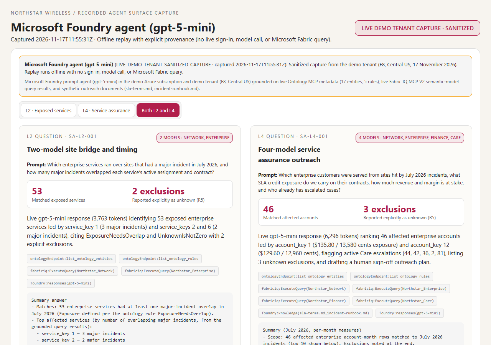

# Microsoft Foundry service assurance agent

This folder defines a pro-code Microsoft Foundry prompt agent over the `Northstar_Service_Assurance` ontology in a demo tenant and demo Azure subscription. The agent uses the [Fabric IQ tool (`fabric_iq_preview`)](https://learn.microsoft.com/en-us/azure/foundry/agents/how-to/tools/fabric-iq) (preview, checked 16 November 2026) pointed at the item-scoped [Fabric IQ ontology MCP endpoint](https://learn.microsoft.com/en-us/fabric/iq/ontology/how-to-use-ontology-mcp-server) (preview, checked 16 November 2026).

`fabric_iq_preview` runs with on-behalf-of (`OBO`) signed-in demo user identity so Microsoft Fabric enforces workspace access and semantic-model row-level security. It replaces the earlier Fabric data agent tool in Microsoft Foundry.

## Files in this folder

| File | Purpose |
|---|---|
| [instructions.md](instructions.md) | Shared ontology rules plus concise Microsoft Foundry outreach-plan instructions (zero copied DAX or contract rules) |
| [create_agent.py](create_agent.py) | Offline `--dry-run` specification builder and guarded `--create --confirm-live` helper |
| [knowledge/sla-terms.md](knowledge/sla-terms.md) | Optional synthetic Northstar Wireless SLA communication and review terms for Foundry IQ |
| [knowledge/incident-runbook.md](knowledge/incident-runbook.md) | Optional synthetic incident triage, Care huddle, and human sign-off runbook for Foundry IQ |

## Prerequisites

Confirm these items in the demo tenant and demo Azure subscription before running live creation (`TODO(verify-live): G5`):

1. **Microsoft Foundry roles**: Assign **Foundry User** (or **Azure AI User**) to create and run prompt agents, and **Foundry Project Manager** (or **Azure AI Project Manager**) to create project connections and optional toolboxes ([Connect Microsoft Foundry agents to Fabric IQ](https://learn.microsoft.com/en-us/azure/foundry/agents/how-to/tools/fabric-iq), checked 16 November 2026).
2. **Fabric capacity and ontology item**: Run a paid `F2` or `P1` or higher Microsoft Fabric capacity in the demo tenant with **Ontology item (preview)** enabled and `Northstar_Service_Assurance` published over the four Direct Lake semantic models (`Network`, `Enterprise services`, `Finance`, `Care`).
3. **Delegated demo user connection**: Configure a Microsoft Foundry project connection (`<CONNECTION_ID>`) using interactive on-behalf-of signed-in user identity. Grant the demo user access to `<WORKSPACE_ID>`, `<ONTOLOGY_ITEM_ID>`, and Read plus Build permissions on all four semantic models. Service principals are not supported on the ontology MCP endpoint ([Use the ontology MCP server](https://learn.microsoft.com/en-us/fabric/iq/ontology/how-to-use-ontology-mcp-server), checked 16 November 2026).

## Environment variables

Keep real workspace, item, project, and connection identifiers outside the repository. Configure the script with these environment variables:

| Variable | Required for `--create` | Description |
|---|---|---|
| `FOUNDRY_PROJECT_ENDPOINT` | Yes | Microsoft Foundry project endpoint, such as `https://<account>.services.ai.azure.com/api/projects/<project>` (`<PROJECT_ENDPOINT>`) |
| `FOUNDRY_MODEL_NAME` | Yes | Deployed model name in the Foundry project, for example `gpt-5-mini` |
| `FABRIC_IQ_PROJECT_CONNECTION_ID` | Yes | Project connection ID or name (`<CONNECTION_ID>`) configured for on-behalf-of user identity |
| `FABRIC_IQ_SERVER_LABEL` | No | Lowercase hyphenated label for the ontology server (defaults to `fabriciq-ontology`) |
| `FABRIC_IQ_SERVER_URL` | Conditional | Full ontology MCP endpoint `https://api.fabric.microsoft.com/v1/mcp/dataPlane/workspaces/<WORKSPACE_ID>/items/<ONTOLOGY_ITEM_ID>/ontologyEndpoint` (optional when both IDs below are set) |
| `FABRIC_WORKSPACE_ID` | Conditional | `<WORKSPACE_ID>` used to build `FABRIC_IQ_SERVER_URL` when that URL is unset |
| `FABRIC_ONTOLOGY_ITEM_ID` | Conditional | `<ONTOLOGY_ITEM_ID>` used to build `FABRIC_IQ_SERVER_URL` when that URL is unset |

## Offline `--dry-run` verification

Preview the exact `PromptAgentDefinition` wire payload and optional toolbox definition from the repository root without installing `azure-ai-projects` or calling any network service:

```bash
python agents/foundry/create_agent.py --dry-run
```

The command exits `0` and prints deterministic JSON containing `kind: "prompt"`, `type: "fabric_iq_preview"`, `require_approval: "never"`, `identity_mode: "on_behalf_of_signed_in_user"`, and the two local knowledge document paths.

## Optional Foundry IQ knowledge and ontology knowledge source

To pair structured ontology answers with synthetic outreach procedures:

1. Attach [knowledge/sla-terms.md](knowledge/sla-terms.md) and [knowledge/incident-runbook.md](knowledge/incident-runbook.md) to a knowledge base in [Foundry IQ](https://learn.microsoft.com/en-us/azure/foundry/agents/concepts/what-is-foundry-iq) (preview, checked 16 November 2026) so the agent cites response windows and the four-point human sign-off gate.
2. Where Azure AI Search agentic retrieval is available in the demo Azure subscription, you can also test the preview [Fabric ontology knowledge source](https://learn.microsoft.com/en-us/azure/search/agentic-knowledge-source-how-to-fabric-ontology) (checked 16 November 2026) alongside `fabric_iq_preview`. Keep all calculations in the semantic models and treat retrieved rules and documents as guidance rather than action permissions.

## Live creation and testing (`TODO(verify-live): G5`)

Install `azure-ai-projects>=2.2.0` and `azure-identity` (or sign in with `az login` for the Foundry `v1` REST API fallback), set your environment variables in the shell, and pass `--create --confirm-live`:

```powershell
$env:FOUNDRY_PROJECT_ENDPOINT = "<PROJECT_ENDPOINT>"
$env:FOUNDRY_MODEL_NAME = "gpt-5-mini"
$env:FABRIC_IQ_PROJECT_CONNECTION_ID = "<CONNECTION_ID>"
$env:FABRIC_WORKSPACE_ID = "<WORKSPACE_ID>"
$env:FABRIC_ONTOLOGY_ITEM_ID = "<ONTOLOGY_ITEM_ID>"
python agents/foundry/create_agent.py --create --confirm-live
```

```bash
export FOUNDRY_PROJECT_ENDPOINT="<PROJECT_ENDPOINT>"
export FOUNDRY_MODEL_NAME="gpt-5-mini"
export FABRIC_IQ_PROJECT_CONNECTION_ID="<CONNECTION_ID>"
export FABRIC_WORKSPACE_ID="<WORKSPACE_ID>"
export FABRIC_ONTOLOGY_ITEM_ID="<ONTOLOGY_ITEM_ID>"
python agents/foundry/create_agent.py --create --confirm-live
```

Open the created `northstar-service-assurance` agent in the Microsoft Foundry playground as the demo user:

1. Run the `L2` two-model question first to verify delegated user authentication against the ontology MCP endpoint.
2. Run the `L4` service assurance question and confirm that the response ranks affected enterprise accounts, cites source measures and home tables across all four models, lists exclusions as unknown, and drafts a human-reviewed outreach plan citing `sla-terms.md` and `incident-runbook.md`.
3. Record the dated verification result under check `G5` in [../../docs/architecture/platform-status.md](../../docs/architecture/platform-status.md). See [../../docs/limitations.md](../../docs/limitations.md) for preview and repository boundaries.

## Sanitized live capture (`17 November 2026`)

[`../../recordings/surface-foundry-agent-2026-11-17.json`](../../recordings/surface-foundry-agent-2026-11-17.json) stores the sanitized live capture (`LIVE_DEMO_TENANT_SANITIZED_CAPTURE`, `17 November 2026`, `F8`, Central US) of `gpt-5-mini` answering both `L2` (`53` exposed services, `2` exclusions) and `L4` (`46` affected enterprise accounts, `3` exclusions). Replay it offline without cloud credentials:

```bash
northstar serve --recorded-library recordings/surface-foundry-agent-2026-11-17.json --port 8767
```



See [../../docs/agents/README.md](../../docs/agents/README.md) for all four agent surfaces.
