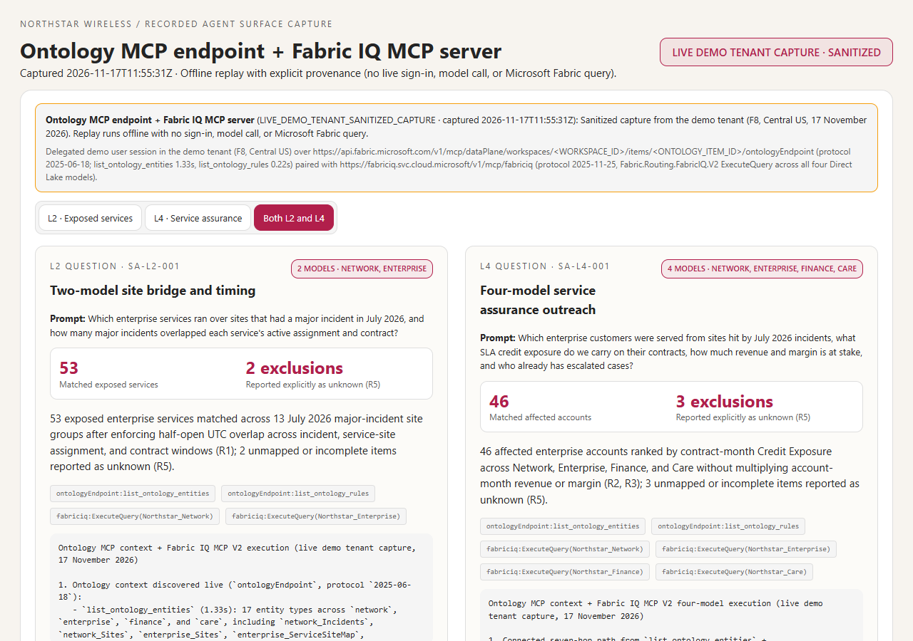
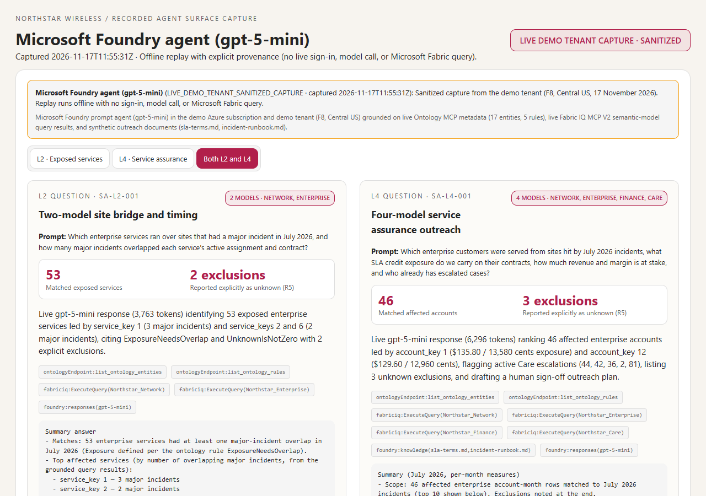
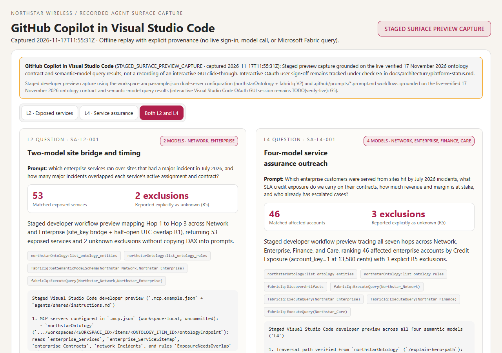
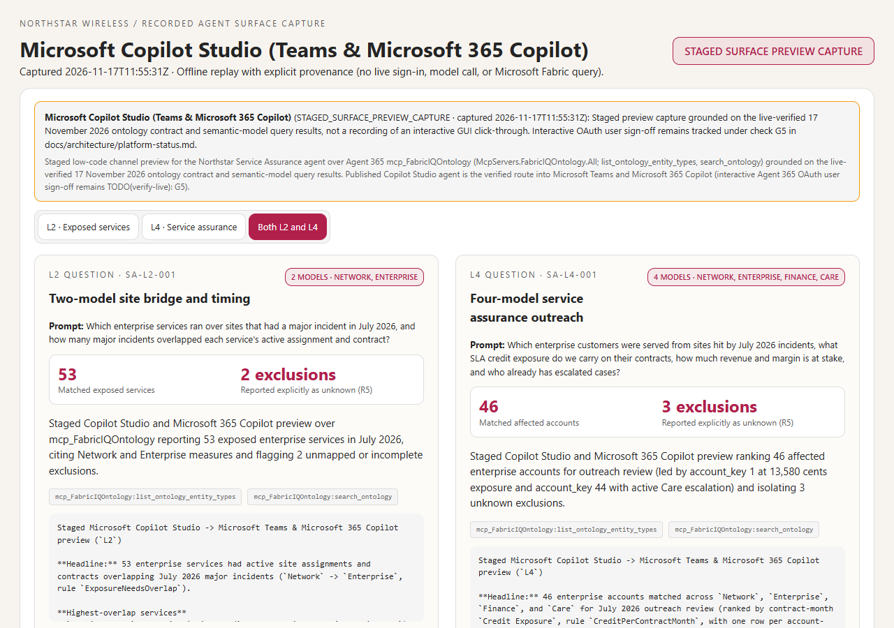

# Agent surfaces over one shared ontology

Every agent in the Northstar service assurance scenario reads entity types, cross-model relationships, metrics linked to source measures, and business rules from one [Fabric IQ ontology](https://learn.microsoft.com/en-us/fabric/iq/ontology/overview) (preview, checked 17 November 2026) while DAX measures and security roles run in their owning Power BI semantic models.

None of the agent instruction files copy DAX formulas or restate rules `R1` through `R5` from [`../../fabric/ontology/service-assurance.json`](../../fabric/ontology/service-assurance.json). Offline contract tests in [`../../tests/test_agent_instructions.py`](../../tests/test_agent_instructions.py) verify that rule statements never leak into prompts.

## Surface index

| Surface | Setup and assets | Availability (checked 17 November 2026) | Capture provenance (`2026-11-17`) | Sanitized recording |
|---|---|---|---|---|
| **Ontology MCP endpoint + Fabric IQ MCP server** | [`../../fabric/ontology/mcp-tools.snapshot.json`](../../fabric/ontology/mcp-tools.snapshot.json) and [agent tooling](../develop/agent-tooling.md) | Ontology MCP endpoint in preview; Fabric IQ MCP server generally available | `LIVE_DEMO_TENANT_SANITIZED_CAPTURE` (`F8`, Central US) | [`../../recordings/surface-fabric-ontology-mcp-2026-11-17.json`](../../recordings/surface-fabric-ontology-mcp-2026-11-17.json) |
| **Microsoft Foundry agent (`gpt-5-mini`)** | [`../../agents/foundry/README.md`](../../agents/foundry/README.md), [`../../agents/foundry/create_agent.py`](../../agents/foundry/create_agent.py), and [`../../agents/foundry/instructions.md`](../../agents/foundry/instructions.md) | Fabric IQ tool (`fabric_iq_preview`) and Foundry IQ in preview | `LIVE_DEMO_TENANT_SANITIZED_CAPTURE` (`F8`, Central US) | [`../../recordings/surface-foundry-agent-2026-11-17.json`](../../recordings/surface-foundry-agent-2026-11-17.json) |
| **GitHub Copilot in Visual Studio Code** | [`github-copilot.md`](github-copilot.md), [`../../.mcp.example.json`](../../.mcp.example.json), and `.github/prompts/*.prompt.md` | Ontology MCP endpoint in preview; Fabric IQ MCP server generally available | `STAGED_SURFACE_PREVIEW_CAPTURE` (`TODO(verify-live): G5` for interactive VS Code OAuth UI) | [`../../recordings/surface-github-copilot-vscode-2026-11-17.json`](../../recordings/surface-github-copilot-vscode-2026-11-17.json) |
| **Microsoft Copilot Studio -> Microsoft Teams and Microsoft 365 Copilot** | [`../../agents/copilot-studio/README.md`](../../agents/copilot-studio/README.md), [`../../agents/copilot-studio/instructions.md`](../../agents/copilot-studio/instructions.md), and [`../../agents/copilot-studio/starter-prompts.md`](../../agents/copilot-studio/starter-prompts.md) | `mcp_FabricIQOntology` through Agent 365 in preview | `STAGED_SURFACE_PREVIEW_CAPTURE` (`TODO(verify-live): G5` for interactive Agent 365 OAuth UI) | [`../../recordings/surface-copilot-studio-m365-2026-11-17.json`](../../recordings/surface-copilot-studio-m365-2026-11-17.json) |

### Shared instructions and starter prompts

- **Shared agent instructions (`<= 25` lines):** [`../../agents/shared/instructions.md`](../../agents/shared/instructions.md)
- **Evaluation ladder starter prompts (`L1` to `L4`):** [`../../agents/shared/starter-prompts.md`](../../agents/shared/starter-prompts.md)
- **Runtime MCP tool discovery snapshot:** [`../../fabric/ontology/mcp-tools.snapshot.json`](../../fabric/ontology/mcp-tools.snapshot.json)

## Fabric data agent and the route into Microsoft 365 Copilot (tested 17 November 2026)

Microsoft Learn contains conflicting preview statements on using an ontology backed by Power BI semantic models as a Fabric data agent source (compare [Create a data agent](https://learn.microsoft.com/en-us/fabric/iq/ontology/how-to-create-data-agent) with [Ontology sources](https://learn.microsoft.com/en-us/fabric/data-science/data-agent-ontology-sources), checked 17 November 2026).

On **17 November 2026**, live testing in the demo tenant (`F8`, Central US) against both the four-model `Northstar_Service_Assurance` ontology and the two-model quickstart ontology confirmed that **a Fabric data agent does not work when the ontology uses semantic models for binding**:

- Querying the Fabric data agent over `Northstar_Service_Assurance` returned *"There's content here I can't work with. Try asking a new question. If that doesn't work, there might be an issue with the content in your source data."*
- Inspecting the underlying graph index definition confirmed empty `nodeTypes`, `edgeTypes`, and `dataSources` projections, matching [Ontology graph](https://learn.microsoft.com/en-us/fabric/iq/ontology/how-to-use-ontology-graph) (*"Entities with data bound to a semantic model aren't supported"*).

**Routing decision for presenters and architects:**

1. **Use the published Microsoft Copilot Studio agent (`Northstar Service Assurance`) as the route into Microsoft 365 Copilot and Microsoft Teams** ([setup guide](../../agents/copilot-studio/README.md)).
2. **Leave the Fabric data agent out of the presenter run of show** while the semantic-model binding limitation remains in preview (tracked in [platform-status.md](../architecture/platform-status.md#capabilities), row 10 and check `G5`).

## Surface captures and offline playback

Play all four surface captures inside the combined viewer (`Service assurance · 4 models` -> **Agent surface captures**):

```bash
northstar serve --recorded-library recordings/northstar-demo-library-v2-2026-10-28.json --port 8767
```

Or open any single surface capture directly:

```bash
northstar serve --recorded-library recordings/surface-foundry-agent-2026-11-17.json --port 8767
```

Recorded mode replays sanitized captures offline with no sign-in, language model call, or Microsoft Fabric query. Do not present recorded or staged preview captures as live session click-throughs.

### 1. Ontology MCP endpoint + Fabric IQ MCP server (`LIVE_DEMO_TENANT_SANITIZED_CAPTURE`)

Live demo tenant capture (`2026-11-17`, `F8`, Central US) combining `list_ontology_entities` (`1.33s`) and `list_ontology_rules` (`0.22s`) on `ontologyEndpoint` with `Fabric.Routing.FabricIQ.V2` `ExecuteQuery` across `Northstar_Network`, `Northstar_Enterprise`, `Northstar_Finance`, and `Northstar_Care`.



### 2. Microsoft Foundry agent (`LIVE_DEMO_TENANT_SANITIZED_CAPTURE`)

Live demo tenant capture (`2026-11-17`, `F8`, Central US) of `gpt-5-mini` answering `L2` (`53` exposed services, `2` unknown exclusions) and `L4` (`46` ranked enterprise accounts, `3` unknown exclusions, Care escalation huddles, and synthetic `sla-terms.md` / `incident-runbook.md` sign-off steps).



### 3. GitHub Copilot in Visual Studio Code (`STAGED_SURFACE_PREVIEW_CAPTURE`)

Staged developer workflow preview (`2026-11-17`) grounded on the live-verified ontology contract and semantic-model query results using `.mcp.example.json` (`northstarOntology` + `fabricIq`). Interactive Visual Studio Code OAuth GUI verification remains tracked under `TODO(verify-live): G5` in [`github-copilot.md`](github-copilot.md) and [`../architecture/platform-status.md`](../architecture/platform-status.md).



### 4. Microsoft Copilot Studio -> Microsoft Teams and Microsoft 365 Copilot (`STAGED_SURFACE_PREVIEW_CAPTURE`)

Staged channel preview (`2026-11-17`) grounded on the live-verified ontology contract and semantic-model query results for the Agent 365 `mcp_FabricIQOntology` path into Microsoft Teams and Microsoft 365 Copilot. Interactive Agent 365 OAuth user verification remains tracked under `TODO(verify-live): G5` in [`../../agents/copilot-studio/README.md`](../../agents/copilot-studio/README.md) and [`../architecture/platform-status.md`](../architecture/platform-status.md).



## Limitations

See [../limitations.md](../limitations.md) for what sanitized live captures and staged preview captures establish versus what requires an interactive demo user session in a demo tenant.
