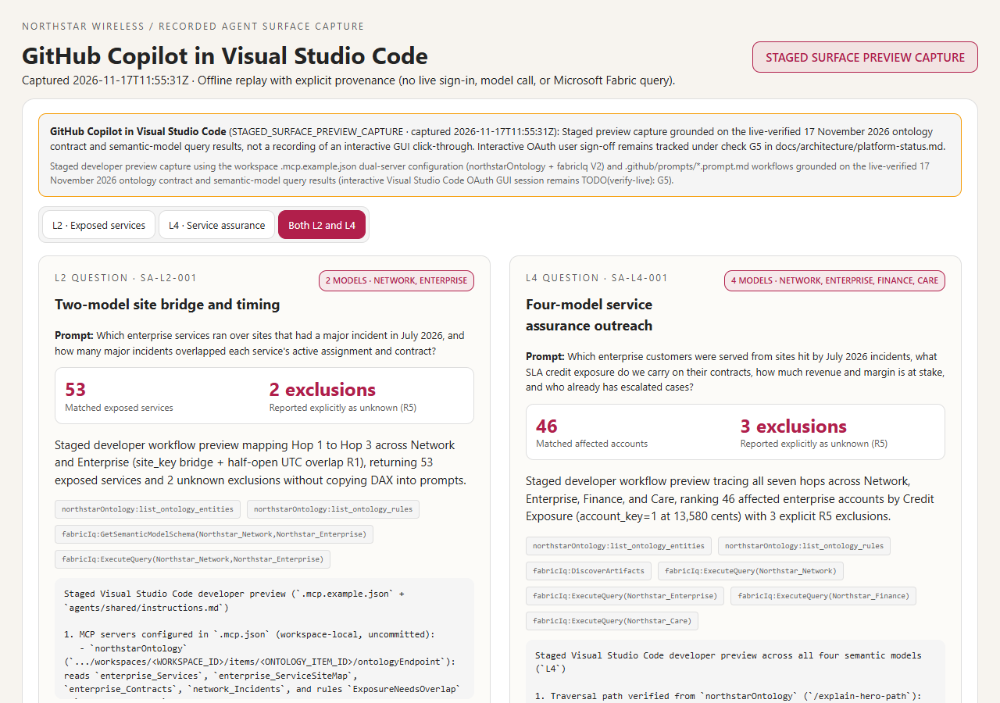

# GitHub Copilot in Visual Studio Code

This guide shows how a developer connects GitHub Copilot in Visual Studio Code to both Microsoft Fabric Model Context Protocol (MCP) endpoints and runs three ontology-grounded workflows without copying DAX formulas or business rules into prompts.

Platform capabilities, preview boundaries, and configuration schemas referenced below were checked on 16 November 2026. Review [../develop/agent-tooling.md](../develop/agent-tooling.md), [../architecture/platform-status.md](../architecture/platform-status.md), [../security.md](../security.md), and [../limitations.md](../limitations.md) before connecting to a demo tenant.

## Two separate MCP endpoints

[`../../.mcp.example.json`](../../.mcp.example.json) registers two distinct remote HTTP MCP servers using the portable `mcpServers` schema from the [Visual Studio Code MCP configuration reference](https://code.visualstudio.com/docs/agents/reference/mcp-configuration) and [Add MCP servers in VS Code](https://code.visualstudio.com/docs/agent-customization/mcp-servers) (checked 16 November 2026):

| Server entry | Endpoint | Availability (checked 16 November 2026) | Role in Visual Studio Code |
|---|---|---|---|
| `fabricIq` | [Fabric IQ MCP server](https://learn.microsoft.com/en-us/fabric/iq/connectors/fabric-iq-mcp) (`https://fabriciq.svc.cloud.microsoft/v1/mcp/fabriciq`) | Generally available | Discover Power BI reports and semantic models, inspect schemas, and run DAX queries with the default version 2 toolset (`Fabric.Routing.FabricIQ.V2`). |
| `northstarOntology` | [Ontology MCP endpoint](https://learn.microsoft.com/en-us/fabric/iq/ontology/how-to-use-ontology-mcp-server) (`https://api.fabric.microsoft.com/v1/mcp/dataPlane/workspaces/<WORKSPACE_ID>/items/<ONTOLOGY_ITEM_ID>/ontologyEndpoint`) | Preview | Read entity types, cross-model relationships, metrics linked to source measures, and natural-language rules for one ontology item on an F2 or P1 [Microsoft Fabric capacity](https://learn.microsoft.com/en-us/fabric/enterprise/pause-resume) or higher. |

Keep both endpoints separate. `fabricIq` does not expose ontology items, and `northstarOntology` targets one ontology item in your demo tenant.

## Connect Visual Studio Code and sign in

1. Copy `.mcp.example.json` to `.mcp.json` at the repository root (ignored by `.gitignore`):

   ```bash
   cp .mcp.example.json .mcp.json
   ```

   ```powershell
   Copy-Item .mcp.example.json .mcp.json
   ```

2. Open `.mcp.json` and replace `<WORKSPACE_ID>` and `<ONTOLOGY_ITEM_ID>` with the workspace and ontology item identifiers from your demo tenant. Never commit `.mcp.json` or paste real identifiers into tracked files.
3. Open the Chat view in Visual Studio Code and sign in interactively as an approved demo user when prompted by each MCP server. Confirm both the signed-in account and the demo tenant before issuing any request.
   - Service principals are not supported on the preview [ontology MCP endpoint](https://learn.microsoft.com/en-us/fabric/iq/ontology/how-to-use-ontology-mcp-server) (checked 16 November 2026).
   - Querying metrics linked to source measures requires Read and Build permissions on the underlying Power BI semantic models, and viewing DAX expressions requires Write permission (see [Use metrics in an ontology](https://learn.microsoft.com/en-us/fabric/iq/ontology/how-to-use-metrics), preview, checked 16 November 2026).
4. Verify runtime tool discovery (`tools/list`) in Visual Studio Code before running a prompt. Tool names on the preview ontology endpoint can vary across updates and are not listed on Microsoft Learn:
   - **`northstarOntology`:** confirm tools for listing entity types (`list_ontology_entities` or `list_ontology_entity_types`), listing rules (`list_ontology_rules`), and asking or searching (`ask_ontology` or `search_ontology`).
   - **`fabricIq`:** confirm the version 2 public tools (`DiscoverArtifacts`, `ResolveFabricItem`, `GetReportMetadata`, `GetSemanticModelSchema`, `ValueSearch`, `ExecuteQuery`).

## Run the three developer workflows

Workspace prompt files live in `.github/prompts/` and follow [Use prompt files in VS Code](https://code.visualstudio.com/docs/agent-customization/prompt-files) (checked 16 November 2026). In Visual Studio Code Chat, select a local agent session and invoke each prompt by slash command (for example `/explain-hero-path`) or run **Chat: Run Prompt** from the Command Palette.

For general data questions across the evaluation ladder (`L1` through `L4`), pair [`../../agents/shared/instructions.md`](../../agents/shared/instructions.md) with [`../../agents/shared/starter-prompts.md`](../../agents/shared/starter-prompts.md).

### 1. Explain the path for the service assurance question

- **Prompt file:** [`../../.github/prompts/explain-hero-path.prompt.md`](../../.github/prompts/explain-hero-path.prompt.md) (`/explain-hero-path`)
- **What it does:** Queries `northstarOntology` (or reads [`../../fabric/ontology/service-assurance.json`](../../fabric/ontology/service-assurance.json) when working offline) to map all seven hops from `Incident` to `Site`, `Service-site assignment`, `Contract`, `SLA evaluation`, `Account`, `Account month`, and `Case`.
- **What to check:** GitHub Copilot identifies the cross-model bridges (`site_key` and `account_key`), the validity intervals, the separate metric grains, and the ontology rules from [../architecture/hero-scenario.md](../architecture/hero-scenario.md) before running any query.

### 2. Find which measure defines credit exposure and where it lives

- **Prompt file:** [`../../.github/prompts/find-credit-exposure-measure.prompt.md`](../../.github/prompts/find-credit-exposure-measure.prompt.md) (`/find-credit-exposure-measure`)
- **What it does:** Traces the `Credit Exposure` metric in `northstarOntology` to `enterprise_SlaEvaluation`, then inspects the `Enterprise` semantic model and `SLA Evaluation` home table through `fabricIq` (`DiscoverArtifacts` and `GetSemanticModelSchema`) or [`../../tools/build_models.py`](../../tools/build_models.py).
- **What to check:** GitHub Copilot reports the home model, home table, grain, unit, and measure metadata from the semantic model while confirming that no DAX expression is stored in the ontology contract.

### 3. Propose a new measure and tests without copying DAX into the ontology

- **Prompt file:** [`../../.github/prompts/propose-measure-and-tests.prompt.md`](../../.github/prompts/propose-measure-and-tests.prompt.md) (`/propose-measure-and-tests`)
- **What it does:** Designs a requested measure in [`../../tools/build_models.py`](../../tools/build_models.py) so semantic-model TMDL owns the calculation, links only the metric metadata in [`../../fabric/ontology/service-assurance.json`](../../fabric/ontology/service-assurance.json), and specifies offline unit and contract tests in `tests/`.
- **What to check:** Generated TMDL files under `fabric/semantic-models/` are never edited by hand, and zero DAX formulas or ontology rule statements are copied into ontology contracts or agent instructions.

## Live verification check

`TODO(verify-live): G5` — Run an approved interactive Visual Studio Code session against your demo tenant to confirm:

1. Both `fabricIq` and `northstarOntology` connect from `.mcp.json` under an approved demo user identity and return expected tool schemas from `tools/list`.
2. GitHub Copilot answers the `L2` starter prompt from [`../../agents/shared/starter-prompts.md`](../../agents/shared/starter-prompts.md) through `northstarOntology`.
3. All three prompt files (`/explain-hero-path`, `/find-credit-exposure-measure`, and `/propose-measure-and-tests`) complete against the live MCP endpoints without copying DAX into the ontology.
4. Record the dated outcome and toolset details under check `G5` in [../architecture/platform-status.md](../architecture/platform-status.md).

## Staged preview capture and offline playback

[`../../recordings/surface-github-copilot-vscode-2026-11-17.json`](../../recordings/surface-github-copilot-vscode-2026-11-17.json) provides a sanitized staged preview capture (`STAGED_SURFACE_PREVIEW_CAPTURE`, `17 November 2026`) grounded on the live-verified ontology contract and semantic-model query results while interactive Visual Studio Code OAuth sign-off remains `TODO(verify-live): G5`. Play it offline without signing in:

```bash
northstar serve --recorded-library recordings/surface-github-copilot-vscode-2026-11-17.json --port 8767
```



See [README.md](README.md) for all four agent surfaces and [../limitations.md](../limitations.md) for recording boundaries.
