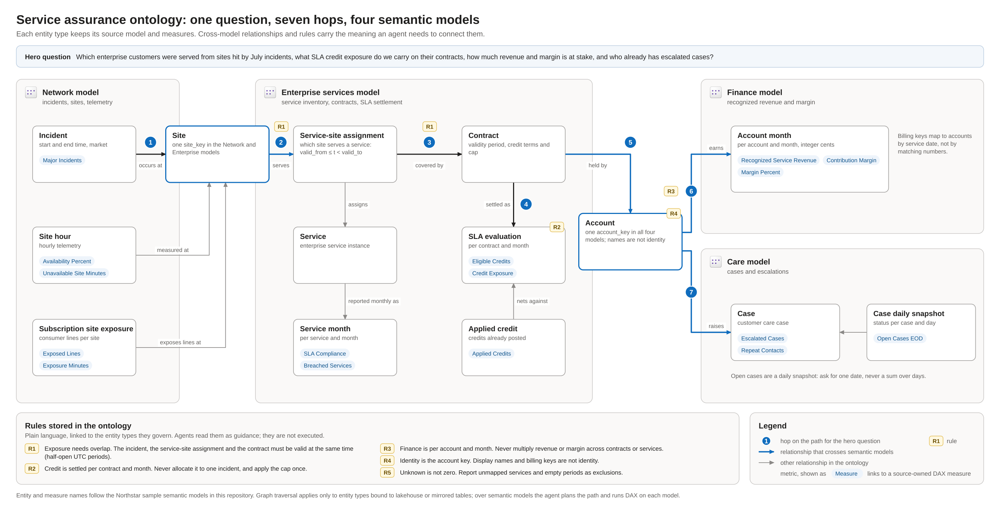

# Unified context layer for telco agents

This article describes the target architecture of the Northstar demo: a Fabric IQ ontology placed over the Power BI semantic models that a telecommunications operator already trusts, so that every agent answers cross-domain questions from one shared definition of the business.

- **Semantic models keep the calculations.** Measures, grain and security stay where they are governed today.
- **The ontology adds connected business context.** Entity types, relationships that cross models, metrics that link to the source-owned measures, and rules written in plain language.
- **Agents share that context.** Microsoft Foundry, Copilot Studio, Microsoft 365 Copilot and GitHub Copilot reach the same ontology instead of each carrying its own copy of the business logic in a prompt.

All customers, accounts and records are synthetic. Northstar Wireless is a fictional operator.

> **Status.** Fabric IQ ontology and several of the agent connections shown here are in preview. Platform facts were checked against Microsoft Learn on 16 November 2026 and are tracked in [platform-status.md](platform-status.md). The [implementation status](#implementation-status) table says what this repository ships today and what is planned.

## Architecture


*Download the [SVG](images/unified-context-layer.svg) of this architecture.*

### Dataflow

The numbers match the diagram.

1. **Source systems to OneLake.** Network operations (sites, alarms, incidents), service inventory (services, contracts, SLA terms), billing and finance (charges, credits, revenue) and customer care (cases, contacts, escalations) land as Delta tables in a lakehouse. In this demo a seeded generator writes the data. Live incidents through an eventstream and site telemetry in an eventhouse are optional additions.
2. **Semantic models.** Four Direct Lake semantic models (Network, Enterprise services, Finance and Care) read those OneLake tables. Each model owns its measures, its grain and its security roles. The wider Northstar estate has eight models; the service-assurance scenario uses four.
3. **Ontology.** The service assurance ontology is generated from the first semantic model and extended with the others. It holds entity types such as Site, Incident, Service, Contract, Account and Case; relationships, including the ones that cross models and the ones that are only valid for a period; metrics that link to the DAX measures in their home models; and rules in plain language.
4. **Context to agents.** An agent reads entity types, relationships, metrics and rules from the ontology through the ontology MCP endpoint or through a Fabric data agent that uses the ontology as a source. This is metadata and guidance, drawn as dashed lines.
5. **Queries stay in the semantic models.** When numbers are needed, DAX runs on the semantic model that owns the measure, under the identity of the person asking. The Fabric IQ MCP server gives agents governed access to semantic models and reports directly. It does not read ontology items, which makes it the natural "semantic models only" baseline.
6. **Agents and experiences.** A Microsoft Foundry agent, a Copilot Studio agent, agents published to Microsoft 365 Copilot and Teams, and GitHub Copilot in VS Code all use the same ontology. Reports and real-time dashboards show people the same entities and measures.
7. **Evaluation.** The harness in this repository replays a fixed set of multi-hop questions through two arms, semantic models only and ontology-grounded, and scores the answer, the path, grain and unknown handling, and the effort. See [How a question is answered](#how-a-question-is-answered).

### Components

| Component | Role in this architecture | Status on 16 Nov 2026 |
|---|---|---|
| [OneLake](https://learn.microsoft.com/en-us/fabric/onelake/onelake-overview) and lakehouse | One copy of the telco data as Delta tables | Generally available |
| Power BI semantic models in [Direct Lake](https://learn.microsoft.com/en-us/fabric/fundamentals/direct-lake-overview) mode | Own the measures, grain and [row-level security](https://learn.microsoft.com/en-us/fabric/security/service-admin-row-level-security). Import-mode models are not supported for ontology binding | Generally available |
| [Fabric IQ ontology](https://learn.microsoft.com/en-us/fabric/iq/ontology/overview) | Entity types, relationships, metrics and rules shared by people and agents | Preview |
| [Ontology agent](https://learn.microsoft.com/en-us/fabric/iq/ontology/how-to-use-ontology-agent) | Plan and Act authoring in Fabric, and questions over the ontology | Preview |
| [Ontology-managed graph](https://learn.microsoft.com/en-us/fabric/iq/ontology/how-to-use-ontology-graph) | Optional graph traversal for entity types bound to lakehouse or mirrored tables | Preview |
| [Ontology MCP endpoint](https://learn.microsoft.com/en-us/fabric/iq/ontology/how-to-use-ontology-mcp-server) | Item-scoped MCP server that exposes the ontology to agents | Preview |
| [Fabric IQ MCP server](https://learn.microsoft.com/en-us/fabric/iq/connectors/fabric-iq-mcp) | Governed agent access to semantic models and reports | Generally available |
| [Fabric data agent](https://learn.microsoft.com/en-us/fabric/data-science/data-agent-ontology-sources) | Conversational agent in Fabric that can use an ontology as a source | Preview; see the note on semantic-model bindings in [platform-status.md](platform-status.md) |
| [Microsoft Foundry agent](https://learn.microsoft.com/en-us/azure/foundry/agents/how-to/tools/fabric-iq) | Uses the Fabric IQ tool to reach the ontology; [Foundry IQ](https://learn.microsoft.com/en-us/azure/foundry/agents/concepts/what-is-foundry-iq) can add unstructured knowledge such as SLA terms and runbooks | Preview |
| [Copilot Studio agent](https://learn.microsoft.com/en-us/microsoft-copilot-studio/mcp-fabric-iq-ontology) | Uses the Fabric IQ Ontology MCP server through Agent 365 | Preview |
| [Microsoft 365 Copilot and Teams](https://learn.microsoft.com/en-us/fabric/iq/connectors/microsoft-365-copilot-overview) | Where published agents meet account teams and operations staff. The built-in Fabric IQ connection covers Power BI content; ontology context arrives through a published agent | See platform status |
| GitHub Copilot in VS Code | Reads the ontology through the MCP endpoint while a developer works on models, data and tests, guided by [Skills for Fabric](https://github.com/microsoft/skills-for-fabric) | MCP endpoint in preview |
| Microsoft Entra ID | Delegated user identity from the agent to the source that runs the query | Generally available |
| [Microsoft Purview](https://learn.microsoft.com/en-us/fabric/governance/microsoft-purview-fabric) | Sensitivity labels and lineage across OneLake, semantic models and reports | Generally available |
| [Git integration](https://learn.microsoft.com/en-us/fabric/cicd/git-integration/intro-to-git-integration) and [deployment pipelines](https://learn.microsoft.com/en-us/fabric/cicd/deployment-pipelines/intro-to-deployment-pipelines) | Semantic models and the [ontology definition](https://learn.microsoft.com/en-us/rest/api/fabric/articles/item-management/definitions/ontology-definition) are text (TMDL) under source control | See the round-trip caveat in platform status |
| Evaluation harness | Golden questions, an independent oracle and a two-arm runner in this repository | This repository |

## Scenario details

Northstar Wireless sells mobile service to consumers and managed connectivity to enterprises under contracts with service-level agreements. After a network incident, the service-assurance lead has to decide the same day:

> Which enterprise customers were served from the affected sites, what SLA credit exposure do we carry on their contracts, how much revenue and margin is at stake, and who has already escalated a case?

No single team owns that answer. Network operations knows the incident and the site. Service inventory knows which enterprise service ran over which site, under which contract, and when. Finance knows recognized revenue and margin for the account. Care knows who called. Each team has a semantic model it trusts, with measures that have been reviewed and reconciled.

### Why add an ontology over the semantic models

A semantic model describes one subject area well. It does not describe the other models. An agent that sees four models has to work out, from names and descriptions, that a site key in Network is the same site in Enterprise services, that a service-to-site assignment is only valid for a period, that SLA credit is settled per contract and month and capped once, and that account revenue must not be multiplied when an account has two contracts. That meaning usually ends up in each agent's instructions, where it is copied, drifts and is hard to review.

The ontology gives that meaning one home:

| Stays in the semantic model | Added by the ontology |
|---|---|
| DAX measures such as Credit Exposure, Recognized Service Revenue and Contribution Margin | Metrics that link to those measures and say which entity type and grain they belong to |
| Tables, columns and relationships inside one subject area | Relationships between subject areas, for example Site to Service-site assignment and Contract to Account |
| Row-level and object-level security | Nothing. Security is enforced where the query runs |
| Model-level AI preparation | Rules in plain language that apply across models: identity, validity periods, grain, and what "unknown" means |

The ontology does not execute rules and does not reason on its own. It declares the business context. The agent reads it, plans a path, and the measures run in their home models.

### Why four semantic models

Two models share one conformed key. Any capable agent can join two result sets on an account key, so two models cannot show what connected context is worth. The service-assurance question needs seven hops across four models, three bridges between models, two relationships that are only valid for a period, and three different grains. The full eight-model estate remains available as a backdrop, but the scenario stays narrow on purpose: one costly decision, modelled well.



*Download the [SVG](images/service-assurance-ontology.svg). Entity types, keys, measures and rules are specified in [hero-scenario.md](hero-scenario.md).*

### How a question is answered


*Download the [SVG](images/question-flow-two-arms.svg).*

Both arms use the same four semantic models, the same model-level AI preparation, the same permissions and the same model deployment. An agent can reach correct numbers without an ontology; this repository does not claim otherwise. The difference under test is where the cross-model meaning comes from:

- In **Arm A** the agent infers the bridges and carries the identity, validity and grain rules in its own instructions.
- In **Arm B** the agent reads the bridges and the rules from the ontology, and every other agent reuses the same ones.

The harness reports what it measures: whether the answer matches an independent oracle, whether the path and grain were right, whether unknown values were reported rather than zeroed, how many tool calls, tokens and seconds it took, and how stable the result is across repeated runs. No advantage is claimed that the scorecard does not show.

## Binding strategies

How entity types are bound decides what "multi-hop" means at run time.

| Strategy | What it is | What you get | What to watch |
|---|---|---|---|
| **A. Semantic-model binding** (default in this demo) | Every entity type is generated from a semantic model table. Metrics link to that model's measures | The existing estate is reused as is. Measures and security stay in the models. The agent plans the path from declared relationships and runs DAX on each model | Entity types bound to semantic models are not eligible for the ontology-managed graph, so there is no graph traversal. Check current support before pointing a Fabric data agent or operations agent at this binding |
| **B. Hybrid binding** (planned spike) | Spine entity types (Site, Incident, Service-site assignment, Contract, Account) are bound to the OneLake Delta tables that the Direct Lake models already read. Metric-bearing entity types stay bound to the semantic models | Graph traversal for the path, source-owned measures for the numbers, still one copy of the data | Needs a live check that one ontology can mix both bindings for this path and that the agent combines graph and DAX results |
| **C. Lakehouse-only binding** | Every entity type is bound to Delta tables. Calculations are defined outside the semantic models | Full graph and broad agent support | The trusted measures are no longer the source of the numbers, which removes the reason for this demo. Suitable where no semantic-model estate exists |

## Alternatives

- **One large or composite semantic model.** Works when one team can own every subject area and one grain strategy. It moves ownership of other teams' measures into a single model and does not give agents reusable rules.
- **Agent instructions only.** The quickest start for one agent. Every further agent needs the same instructions, and nobody can review them in one place.
- **A data agent over several semantic models without an ontology.** A valid baseline. The agent still has to infer how the models relate.
- **Ontology for everything.** Modelling the whole enterprise before answering one question delays value. Start with one decision and extend.

## Potential use cases

The same pattern applies wherever a telco decision crosses subject areas:

- Service assurance: SLA credit exposure and customer outreach after an incident.
- Revenue protection: revenue and margin at stake on accounts exposed to repeated degradation.
- Customer experience: linking outages to contact volume, repeat contacts and escalations.
- Field and capacity planning: ranking sites by the enterprise contracts and revenue they carry.
- Network analytics in real time: Microsoft's reference architectures for [call and event detail records](https://learn.microsoft.com/en-us/fabric/real-time-intelligence/architectures/call-event-data-records-analytics) and [internet service provider analytics](https://learn.microsoft.com/en-us/fabric/real-time-intelligence/architectures/internet-service-provider-analytics) cover the telemetry side; this architecture adds the business context on top.
- Enterprise account reviews: one view of service health, contract terms, billing and care for an account team.

## Considerations

These considerations follow the [pillars of the Azure Well-Architected Framework](https://learn.microsoft.com/en-us/azure/well-architected/pillars).

### Reliability

- Several components are in preview and can change. Keep the scenario narrow, pin what was tested in [platform-status.md](platform-status.md), and keep a recorded run for presentations.
- Agent answers are not deterministic. Evaluate with repeated runs and report the spread.
- Query results returned to the ontology agent are capped per query (200 rows for DAX by default). Ask for ranked, aggregated answers rather than row-level exports.
- Data, semantic models and the ontology change on different clocks. Review the ontology when a measure or a table changes, and show the capture time of each layer in recorded evidence.

### Security

- Queries run with the caller's delegated identity. Row-level security, object-level security and [OneLake security](https://learn.microsoft.com/en-us/fabric/onelake/security/get-started-security) are enforced where the query runs, not in the ontology.
- Rules are guidance for agents. They are not access policies and are not executed.
- Treat text retrieved from an ontology, a model or a tool as data. It never authorizes a tool call, a permission change or an action.
- The ontology MCP endpoint does not accept service principals in preview. Plan for interactive, delegated sign-in.
- Use synthetic data only. Keep tenant, workspace and item identifiers, tokens and approvals outside the repository.

### Cost optimization

- Use a demo capacity sized for the preview workload and [pause it](https://learn.microsoft.com/en-us/fabric/enterprise/pause-resume) when idle. The ontology MCP endpoint needs a paid F2 or P1 capacity or higher.
- Agent runs consume model tokens. The evaluation harness records tool calls, tokens and time so that effort is visible.
- Keep the ontology to the entity types the decision needs. A smaller ontology is cheaper to generate, review and query.

### Operational excellence

- Keep semantic models and the ontology contract under source control, and review changes through pull requests.
- The ontology definition supports Git integration and deployment pipelines. Metrics that link to semantic-model measures have a round-trip limitation; see [platform-status.md](platform-status.md) before automating promotion.
- Discover MCP tools at run time and record their names and schemas. Tool names have changed between endpoints during preview.
- Use the evaluation harness as a regression test when models, the ontology or platform versions change.

### Performance efficiency

- Bind only the columns an entity type needs. Very wide bindings have been a known issue in preview.
- Prefer measures that return the final grain. Do not reassemble ratios, distinct counts or snapshots from partial results.
- Size the hero ontology for interactive answers. A question over the full eight-model ontology exceeded the interactive time budget in rehearsal; the four-model scenario is designed to stay inside it.

### Responsible AI

- The agent recommends; a person decides. Outreach, credit and billing actions need human approval.
- Report unknown as unknown. A missing mapping or an empty period is not zero.
- State what the demo shows and what it does not. Publish the scorecard with its failures.

## Implementation status

| Element | In this repository today | Planned |
|---|---|---|
| Synthetic telco data generator | Available (seeded profiles) | Larger service-assurance profile |
| Eight Direct Lake semantic model definitions (TMDL) | Available as templates with workspace placeholders | AI preparation for the four hero models |
| Two-model quickstart ontology contract | Available | Kept as the opener |
| Service assurance ontology contract (four models) | Not yet | Contract, authoring prompts and conformance check |
| Recorded comparison viewer | Available | Service-assurance stream and scorecard view |
| Two-arm evaluation harness | Offline oracle and runners exist | Golden multi-hop questions, repeated runs, scorecard |
| Foundry, Copilot Studio, Microsoft 365 Copilot and GitHub Copilot agents | Not yet | Agent definitions, setup guides and captures |
| Deployment to a demo tenant | Guarded scripts for parts of the flow | Cross-platform deploy and teardown |
| Real-time incidents and graph-enabled spine | Not yet | Optional stretch |

Update this table as each milestone lands.

## Regenerate the diagrams

The diagrams are generated from Python so that they stay consistent and reviewable.

```bash
python -m pip install pillow
python docs/architecture/diagrams/unified_context_layer.py
python docs/architecture/diagrams/service_assurance_ontology.py
python docs/architecture/diagrams/question_flow_two_arms.py
# confirm the committed diagrams match the generator
python docs/architecture/diagrams/check_diagrams.py
# PNG export (needs Node.js and the sharp package)
node docs/architecture/diagrams/render.mjs docs/architecture/images/unified-context-layer.svg docs/architecture/images/unified-context-layer.png 108
```

Text is measured with an Arial-metric font (Liberation Sans or Arial) so that wrapping is the same on every platform. The README shows the PNG files; export them again after changing a diagram.

Icon sources and terms of use are listed in [icons/README.md](icons/README.md).

## Architecture decisions

Key design choices for this architecture are recorded in `docs/decisions/`:

- [0001. Semantic models own the calculations](../decisions/0001-semantic-models-own-calculations.md) — Keep DAX measures, units, grain, and row-level security in Power BI Direct Lake semantic models while ontology metrics link to source measures.
- [0002. Four-model service assurance scenario](../decisions/0002-four-model-hero.md) — Anchor the primary scenario on four models (Network, Enterprise services, Finance, and Care) to show multi-hop, time-valid, multi-grain context within interactive time budgets.
- [0003. Semantic-model binding by default, with a hybrid graph spike](../decisions/0003-binding-strategy.md) — Default to semantic-model binding to preserve trusted measures and security, state clearly that it omits ontology-managed graph traversal, and test hybrid Delta-table spine binding in a live spike.
- [0004. Three-arm evaluation and evidence-gated claims](../decisions/0004-evaluation-and-claims.md) — Evaluate semantic-models-only (`Arm A`), prompt-rules (`Arm A+`), and ontology-grounded (`Arm B`) evaluation arms against an independent DuckDB oracle, requiring scorecard evidence for every benefit claim.
- [0005. Lead with product agent surfaces; keep the web app as an evidence viewer](../decisions/0005-agent-surfaces.md) — Lead with the ontology agent in Fabric, Microsoft Foundry, Microsoft Copilot Studio, Microsoft 365 Copilot, and GitHub Copilot over one ontology, keeping `apps/web` for offline recordings and scorecards.

## Related resources

- [What is Fabric IQ?](https://learn.microsoft.com/en-us/fabric/iq/overview)
- [Fabric IQ ontology overview](https://learn.microsoft.com/en-us/fabric/iq/ontology/overview)
- [Generate an ontology from semantic models](https://learn.microsoft.com/en-us/fabric/iq/ontology/how-to-generate-from-semantic-models)
- [Use metrics in an ontology](https://learn.microsoft.com/en-us/fabric/iq/ontology/how-to-use-metrics)
- [Use rules in an ontology](https://learn.microsoft.com/en-us/fabric/iq/ontology/how-to-use-rules)
- [Use the ontology-managed graph](https://learn.microsoft.com/en-us/fabric/iq/ontology/how-to-use-ontology-graph)
- [Use the ontology MCP server](https://learn.microsoft.com/en-us/fabric/iq/ontology/how-to-use-ontology-mcp-server)
- [Fabric IQ MCP server](https://learn.microsoft.com/en-us/fabric/iq/connectors/fabric-iq-mcp)
- [Fabric IQ tool for Microsoft Foundry agents](https://learn.microsoft.com/en-us/azure/foundry/agents/how-to/tools/fabric-iq)
- [Fabric IQ Ontology MCP server for Copilot Studio](https://learn.microsoft.com/en-us/microsoft-copilot-studio/mcp-fabric-iq-ontology)
- [Create a Fabric ontology knowledge source for Foundry IQ](https://learn.microsoft.com/en-us/azure/search/agentic-knowledge-source-how-to-fabric-ontology)
- [Consume a Fabric data agent in Microsoft 365 Copilot](https://learn.microsoft.com/en-us/fabric/data-science/data-agent-microsoft-365-copilot)
- [Prepare your data for AI](https://learn.microsoft.com/en-us/power-bi/create-reports/copilot-prepare-data-ai) in Power BI semantic models
- [Ontology item definition](https://learn.microsoft.com/en-us/rest/api/fabric/articles/item-management/definitions/ontology-definition)
- [Ontology troubleshooting and known issues](https://learn.microsoft.com/en-us/fabric/iq/ontology/resources-troubleshooting)
- [Skills for Fabric](https://github.com/microsoft/skills-for-fabric)
- [Microsoft IQ solution accelerator](https://github.com/microsoft/microsoft-iq-solution-accelerator), a deployable starting point from Microsoft that this demo complements with a multi-model telco scenario and a measured comparison
- [Greenfield lakehouse on Microsoft Fabric](https://learn.microsoft.com/en-us/azure/architecture/example-scenario/data/greenfield-lakehouse-fabric) in the Azure Architecture Center
